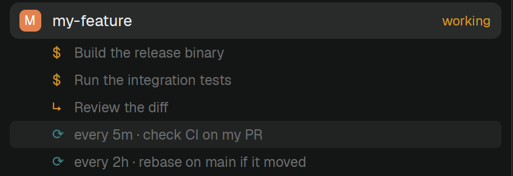

# Spaces Status

A [Herdr](https://herdr.dev) mod: the Spaces list, plus what the coding agent in each space is doing. After a space's name it shows `working`, `blocked` or `error`, and under it the agent's background shells, subagents and loops. Click a row to see the full command or prompt.



It works for agents Herdr can't see on its own, such as Claude Code running in tmux inside a Docker container. The data comes from the [agent-status-json](https://github.com/paneq/agent-status-json) Claude Code mod, which writes `~/.maestro/_herdr_mod/<session-id>/agent-status.json`.

## Install

1. Install the Claude Code mod in every session you want to see:

   ```
   /plugin install agent-status-json --marketplace paneq/agent-status-json
   ```

2. Give your Herdr agent this line:

   > Read ~/.config/herdr-app/AGENTS.md, then add this mod: https://github.com/paneq/herdr-spaces-status

   Or by hand: copy `mods/spaces-status/` to `~/.config/herdr-app/mods/`, clone your layout if it is a shipped one (`herdr-app do layout.clone '{"name":"main","as":"my-layout"}'`), and in your layout's JSON change the Spaces block's `"mod": "spaces"` to `"mod": "spaces-status"`.

## How it matches spaces to sessions

A space whose folder ends in `-<8 hex characters>` (how Maestro names its session workspaces) matches the session whose Maestro session id starts with them (the Claude Code mod records `MAESTRO_SESSION_ID`, which stays the same when a conversation is resumed). Any other space matches the session whose working directory is the space's folder.

## What it runs

Besides what Herdr's own Spaces mod runs (`git`, `hc`), it runs `sh` to read the status files under `~/.maestro/_herdr_mod`. It doesn't reach the network.

## License

Apache-2.0. `mods/spaces-status/main.js` is a modified copy of Herdr's shipped `spaces` mod (see `NOTICE`).
