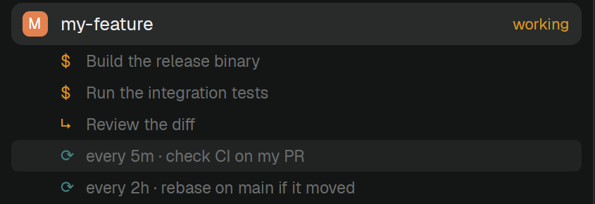

# Spaces Status

Herdr's Spaces list, plus what the coding agent in each space is doing: a state word after the space's name, and under it one row per background shell, subagent, monitor or workflow, and one per loop or scheduled wakeup. It shows agents Herdr's Agents list can't see, such as Claude Code running inside tmux in a Docker container. The data comes from the [agent-status-json](https://github.com/paneq/agent-status-json) Claude Code mod.

## What you see

Everything the shipped `spaces` mod shows, unchanged: colored avatar, name, repo, branch, ahead/behind, machine groups, worktrees under their checkout. On top of that:

- **State after the name.** At the row's right end, after the git tail: `working` in the theme's `working` color, `blocked` in its `blocked` color, `error` in `ansi1`. Nothing for `idle`.
- **Rows under the space, 20px tall, indented 35px, 11.5px text, dim.** Each row has a 12px icon column and one truncated line:
  - `$` shell, `↳` subagent, `◉` monitor, `⚙` workflow, in the theme's `working` color, followed by the task's description (the short sentence the agent gave the tool call), or its command when there is no description.
  - `⟳` loop, in `ansi4`, followed by the schedule in words and the prompt: `every 5m · check CI on my PR`. `*/N * * * *` reads `every Nm`, `M */N * * *` reads `every Nh`, any other cron is shown as written.
- The narrow (rail) view is unchanged: no rows under spaces.

## How it behaves

- Rows highlight on hover (rounded 5px, `hover` background, `foreground` text).
- Clicking a row unfolds the full text under it, wrapped, 11px, `muted`: the full command for a task, the raw cron line and the full prompt for a loop. Clicking again folds it. Clicks don't select the space.
- The list follows the files: it reloads when anything under the status folder changes and every 10 seconds as a fallback.
- States: `working` while a turn runs; `blocked` while a permission prompt, a question or a dialog waits; `idle` after a turn; `error` when a turn ended on an API error; a file in state `ended` is hidden.
- Background tasks and loops are what the agent reported when its last turn (or subagent) ended; a shell that finishes while the agent is idle stays until the agent's next turn.

## Built from

- A clone of the shipped `spaces` mod (`herdr-app do mod.clone '{"name":"spaces","as":"spaces-status"}'`), placed in a layout of your own where the `spaces` block was (`"content": { "mod": "spaces-status" }`). It has no props.
- Status files: `~/.maestro/_herdr_mod/<session-id>/agent-status.json` (`home()` + that path), one per Claude Code session, written by agent-status-json:
  `{ v, session_id, cwd, state, event, updated_at, background_tasks: [{ id, type, status, description, command? }], loops: [{ id, schedule, recurring, prompt }] }`.
- Reading: `exec("sh", ["-c", …])` cats every `*/agent-status.json` in one call, separated by `\x1e`, and parses each; `watchFolder` on the status folder wakes it; `cx.timer.every(10000, …)` is the fallback.
- Matching a space to a session: a space whose `folder` ends in `-<8 hex>` matches the session whose `session_id` starts with those 8 characters (Maestro names its workspaces this way); any other space matches by `cwd === folder`. The newest `updated_at` wins; spaces on other machines are skipped.
- `herdr` functions: the shipped mod's, plus `home`. Programs it runs beyond the shipped mod's `git` and `hc`: `sh`.

## Watch out

- `.tooltip()` didn't show on these rows in Herdr 0.1.9, so the full text is click-to-unfold instead.
- The `draw` in `grouped` returns a list per space (the row and its detail rows), so the callers use `flatMap`.
- The folder `~/.maestro/_herdr_mod` may not exist yet; `watchFolder` then rejects and only the 10-second timer reloads.
- Status files of sessions that died without a clean exit stay until deleted.
- Being a clone, it doesn't get the shipped `spaces` mod's updates.

## Done when

- With a status file whose `session_id` starts with a Maestro space's 8-character suffix, that space shows the state word and one row per task and loop.
- A file change shows within a second; deleting the file removes the rows within 10 seconds.
- Clicking a row unfolds and folds the full command or prompt, and doesn't switch spaces.
- `herdr-app check ~/.config/herdr-app/mods/spaces-status` passes.
